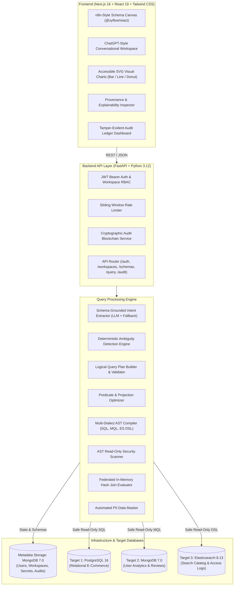
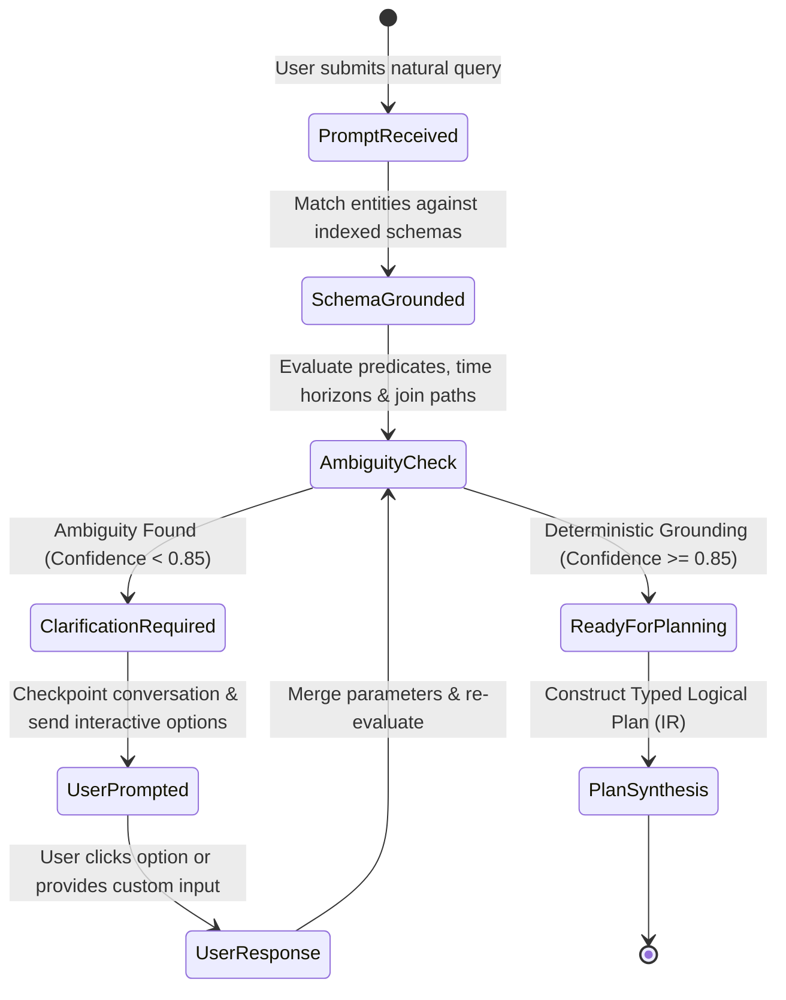
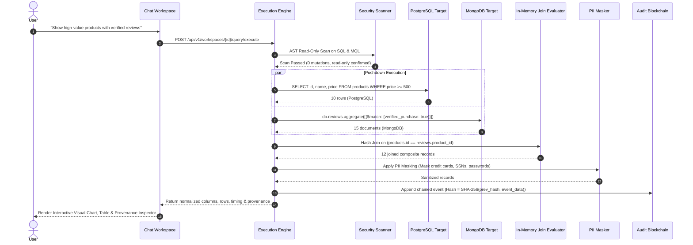
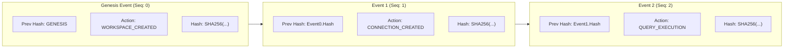

# Architecture and System Design

## Ambiguity-Aware Natural Language Query Engine for Heterogeneous Databases

### 1. Executive Summary

The **Ambiguity-Aware Natural Language Query Engine** allows non-technical users to query heterogeneous data sources (PostgreSQL, MongoDB, and Elasticsearch) using ordinary natural language. 

Unlike traditional Text-to-SQL solutions that silently guess missing constraints or hallucinate database objects, this engine:
1. **Discovers & Indexes Schemas**: Performs automated introspection across relational, document, and search systems, tracking schemas with deterministic SHA-256 fingerprints.
2. **Detects Ambiguity Deterministically**: Analyzes user prompts for vague predicates ("high-value", "top"), temporal ambiguity ("recently", "this year"), and competing join paths *before* building execution plans.
3. **Engages in Structured Clarification**: Renders interactive, multi-option parameter prompts in the chat workspace. Execution is paused safely until the user confirms their intent.
4. **Builds a Typed Intermediate Representation (IR)**: Generates a database-agnostic `LogicalQueryPlan` containing projections, filters, joins, groupings, and pagination.
5. **Compiles Heterogeneous Dialects**: Translates the IR into target dialect syntax:
   - **PostgreSQL**: Parameterized ANSI SQL (`SELECT ... FROM ... JOIN ... WHERE ...`)
   - **MongoDB**: Aggregation Pipelines (`[{"$match": ...}, {"$group": ...}, {"$project": ...}]`)
   - **Elasticsearch**: Query DSL (`{"query": {"bool": {"filter": [...]}}}`)
6. **Executes Safely with In-Memory Federation**: Dispatches read-only queries with strict AST verification, joins heterogeneous streams via an in-memory hash join evaluator, and automatically masks sensitive PII.
7. **Maintains a Cryptographic Audit Blockchain**: Chained SHA-256 event logging with strict monotonicity guarantees tamper-evident provenance across every query and workspace action.

---

### 2. High-Level Component Topology

---

### 3. Detailed Subsystem Workflows

#### 3.1 Ambiguity Detection & Clarification State Machine

#### 3.2 Heterogeneous Query Compilation & Federated Join Pipeline

---

### 4. Cryptographic Audit Blockchain Architecture

To ensure tamper-evidence and regulatory compliance, the engine maintains a cryptographically chained audit ledger:

- **Monotonic Sequence**: Every event receives an incrementing integer `sequence`.
- **SHA-256 Hashing**: Hash is calculated from `sequence`, `workspace_id`, `action`, `resource_type`, `user_id`, `status`, integer epoch seconds timestamp, and `previous_hash`.
- **Tamper Detection**: Altering or deleting any past event invalidates the hash chain, immediately detected by `verify_integrity()`.

---

### 5. Multi-Database Provisioning Topology

| Container Service | Image | Internal Port | Host Port | Role |
| :--- | :--- | :--- | :--- | :--- |
| **`metadata-db`** | `mongo:7.0` | 27017 | 27017 | Users, Workspaces, Encrypted Secrets, Audit Ledger |
| **`postgres-target`** | `postgres:16-alpine` | 5432 | 5432 | Target E-Commerce Relational Database (`ecommerce_demo`) |
| **`mongo-target`** | `mongo:7.0` | 27017 | 27018 | Target User Analytics & Product Reviews (`analytics_demo`) |
| **`elasticsearch-target`**| `elasticsearch:8.13.0`| 9200 | 9200 | Target Full-Text Product Catalog & Access Logs (`catalog`, `access_logs`) |
| **`backend`** | Custom Python 3.12 | 8000 | 8000 | FastAPI REST API, Ambiguity Engine, Query Compilers |
| **`frontend`** | Custom Node.js 20 | 3000 | 3000 | Next.js 16 App Router Production Web Interface |
